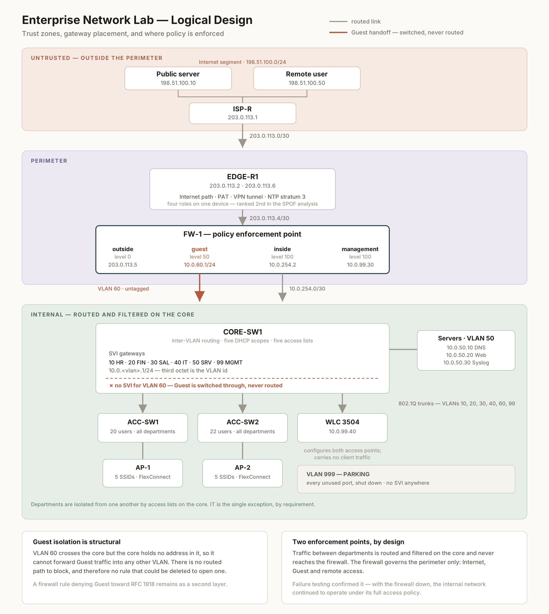

# Screenshots

Eight images. The first is the design drawn; the rest are captures from the
running network, each chosen because it proves something a configuration file
cannot.

A configuration shows what was *typed*. These show what the network *does*.

---

## The design

### `topology-logical.png`



The network as designed rather than as cabled: three trust zones descending from
untrusted at the top to internal at the bottom, every gateway address, and the
two points where policy is enforced.

Three things in this diagram are not visible in any topology screenshot:

- **The firewall's security levels** — `0` outside, `50` guest, `100` inside. The
  `50` is the interesting one: visitors are not the Internet, but they are not
  trusted either, and the number places them between.
- **The dashed line inside the core**, marking that VLAN 60 passes through
  without a gateway. This is the mechanism of guest isolation, and it is an
  absence, so nothing else can show it.
- **The edge router's four roles** — Internet path, PAT, VPN termination and time
  reference. A device with two interfaces looks simple; the caption says why it
  is not, and why it ranks second in the failure analysis.

---

## The build

### `01-topology.png`

The network in Packet Tracer. Six infrastructure devices, three servers, two
access points, a wireless controller, and the simulated provider side carrying a
public server and a remote client.

Every link indicator is green. This is the unglamorous image that matters: it
shows the thing exists and runs.

### `02-wlc-interfaces.png`

The wireless controller's interface table.

Worth reading closely: the controller holds an address in **every VLAN it
serves** — `10.0.10.2`, `10.0.20.2`, `10.0.30.2`, `10.0.40.2`, `10.0.60.2` — and
each one sits at `.2`, the first address of the infrastructure block reserved in
the addressing plan.

That block was set aside during logical design, before the controller existed as
a device in the build. The controller was added later and fitted into space the
plan had already kept for it, with no collision and no renumbering. Reserved
ranges earn their keep exactly like this, and usually only in hindsight.

The `virtual` interface at `192.0.2.1` is not a real address: it is the
controller's internal endpoint for client mobility, and no packet carries it on
the wire.

---

## Policy, proven by traffic

### `03-wireless-vlan.png`

A laptop joined to `CORP-FINANCE`, showing its address configuration.

| Field | Value | What it proves |
|---|---|---|
| Interface | `Wireless0` | Wireless, not cabled |
| Mode | **DHCP** | Automatic — nothing was typed by hand |
| IPv4 | `10.0.20.103` | VLAN 20, inside the `.100–.199` pool |
| Gateway | `10.0.20.1` | The core's SVI for VLAN 20 |
| DNS | `10.0.50.10` | The internal resolver, as the scope specifies |

The `20` in the third octet is the whole point. The user selected a network name;
the network placed them in their own department's VLAN with the correct
parameters, automatically. That is the wireless requirement satisfied.

### `04-guest-isolation.png`

Two pings from a guest client, in one window.

```
ping 198.51.100.10    →  4 replies, 0% loss, TTL=125
ping 10.0.50.10       →  4 timeouts, 100% loss
```

A visitor reaches the Internet and is denied the internal server segment. One
capture, the entire guest policy.

**The TTL is the part worth noticing.** 125 means three hops from the initial 128:
firewall, edge router, ISP. A corporate client pinging the same address shows
**124** — four hops, because the core routes it. The one-hop difference is the
core, and it is numeric proof that guest traffic crosses the core without being
routed by it.

That evidence was not designed into the test. It fell out of a troubleshooting
session, and it demonstrates the design's central mechanism better than a test
written for the purpose would have.

### `04c-guest-dhcp-fails.png`

The same guest client with DHCP selected: every field empty, gateway `0.0.0.0`,
no address.

This is a documented deviation, not a fault in the build. The firewall stores the
guest address pool and reports the interface as configured for DHCP service, but
refuses the command that starts it — the device contradicting its own
configuration. Guest clients in the lab are addressed statically from the same
range.

Included because a limitation shown is more credible than a limitation described.

### `05-vpn-finance.png`

A remote workstation connected with **Finance** credentials:

```
ping 10.0.50.10    →  replies, TTL=125
ping 10.0.99.1     →  100% loss
```

The remote user reaches the permitted server and is denied the management VLAN.
With IT credentials, the same workstation and the same tunnel reach both — the
difference comes from which address pool the client receives, which is what lets
the firewall apply a different rule to each group.

**TTL=125 again, and here it matters more.** Three hops means edge router,
firewall, core. The traffic went *through* the firewall. The tunnel terminates on
the edge router — a deviation forced by the platform — and this number is the
proof that moving it did not move policy enforcement with it.

### `06-syslog.png`

Central log collection on the monitoring server: five events from one switch, in
order, with timestamps to the millisecond.

The timestamps are there because they had to be configured explicitly. Without
`service timestamps`, the messages still arrive and still carry their text — the
collection looks like it is working — while the one property that makes them
useful for reconstructing a sequence is silently missing. It was diagnosed by
capturing a message in simulation mode and reading the inbound packet.

**The 1993 date is not an error.** The lab has no external time source, so devices
start from the IOS default. What log correlation requires is that devices agree
with *each other*, which they do: every message here carries a consistent time
from a shared reference. Absolute accuracy is the lesser property, and its absence
is recorded in the deviation register.

---

## What these images do not show

No screenshot here shows a denied connection being *logged*, because no device in
this build can record a rule match. The firewall implements no logging at all,
and the switches reject the `log` keyword on access list entries.

Everything above is a control working. None of it would leave a trace.

